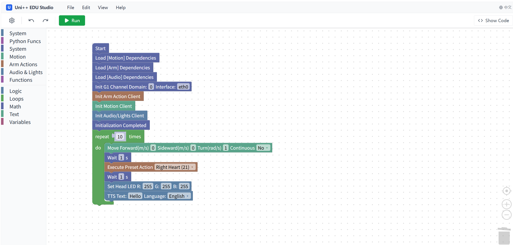

# Uni++ EDU Studio



Uni++ EDU Studio It is an open graphical programming platform for Unitree robots base on Blockly.

Uni++ EDU Studio supports running on any Linux platform, but for convenience, it is recommended to deploy on:

* Unitree G1's PC2
* Unitree Go2's docking station

Uni++ EDU Studio supports controlling different robots by importing configurations. Built-in reference configurations in this repo:

* Unitree G1 (`block_configurations/g1_basic`)
  * High-level locomotion (safe actions only)
  * Arm actions (including recorded actions)
  * Audio & lights
* Unitree Go2 (`block_configurations/go2_basic`)
  * Sport / obstacles avoid / service switch / VUI / UTLidar switch
* Unitree AS2 (`block_configurations/as2_basic`)
  * Sport control (SportClient)
* Unitree R1 (`block_configurations/r1_basic`)
  * High-level locomotion (LocoClient)
* Unitree H2 (`block_configurations/h2_basic`)
  * High-level locomotion (LocoClient)

Configurations will be continuously updated, and custom configurations are also supported.

The Uni++ EDU Studio editor supports:

* One-click local execution
* Custom functions (Graphical or Python)
* Custom code snippets (Python)

---

## Quick Start

Note: The operations here require a certain foundation in Unitree robot development.

### 0000 Connect to the Robot

Taking Unitree G1 as an example, refer to this tutorial to connect the robot:

[Unitree Robotics Documentation Center](https://support.unitree.com/home/en/G1_developer/quick_development#heading-7)

### 0001 Copy the Program to the Robot's Internal Computer

It is recommended to use the SCP tool to transfer the program to the robot's internal computer after packaging it into a ZIP file.

Taking Unitree G1 as an example. (Replace `/path/to/your/zip` with the path of your packaged compressed file)

```bash
scp /path/to/your/zip.zip unitree@192.168.123.164:/home/unitree/
ssh unitree@192.168.123.164
password:123
mkdir unipp-edu-studio
mv /your/zip.zip unipp-edu-studio
cd unipp-edu-studio
unzip

```

Alternatively, you can use MobaXterm for graphical operations.

### 0002 Set Internal Computer to Connect to Wireless Network (To Configure Environment)

Replace `<ssid>` with your environment's Wi-Fi name and `<password>` with the password.

```bash
sudo nmcli device wifi connect <ssid> password <password>

```

Next, you need to remember the robot's IP address. Check it via `ifconfig`. Then open a new SSH session and **connect to the robot using the address you just noted**. Temporarily disable the local network card.

```bash
ssh unitree@<ip>
password:123
sudo ifconfig eth0 down

```

### 0003 Install Dependencies

Clone the dependencies in the `backend` directory (unitree sdk2 python).

```bash
cd backend
git clone https://github.com/unitree/unitree_sdk2_python.git

```

Return to the home directory, clone and install cyclone dds.

```bash
cd ~
git clone https://github.com/eclipse-cyclonedds/cyclonedds -b releases/0.10.x 
cd cyclonedds && mkdir build install && cd build
cmake .. -DCMAKE_INSTALL_PREFIX=../install
cmake --build . --target install

```

Return to the `backend` directory, create a virtual environment using miniconda (pre-installed in PC2), and configure the Unitree SDK2 Python dependencies.

```bash
cd ~/unipp-edu-studio
conda create -n UnippEduStudio python=3.10
conda activate UnippEduStudio
export CYCLONEDDS_HOME="/home/unitree/cyclonedds/install"
pip install -e .

```

Then install other required dependencies.

```bash
pip install fastapi uvicorn pydantic

```

### 0004 Startup

Return to the `backend` directory and start the program.

```bash
cd ~/unipp-edu-studio/backend
python -m server

```

Note that for future use, you need to activate the `UnippEduStudio` environment using conda first.

```bash
conda activate UnippEduStudio

```

Subsequently, you can access the robot's `IP address:5179` under the same Wi-Fi to enter Uni++ EDU Studio.

## Usage Instructions

### 1001 Import Configuration

Click the ⚙️ icon in the top left corner of the interface to expand the configuration menu. Click "**⬆️ Import Configuration**" to import a configuration file in `.json` format, such as the `g1_basic_en.json` file located in `/block_configurations`. Note that different robots/languages require different configuration files.

### 1002 Programming and Saving

Once configured, you are free to start programming. After completing your work, you can select "**Download Project File**" from the "File" menu. When reopening a project in the future, please ensure you import the corresponding configuration file first; otherwise, the import will fail.

When programming, remember that to use specific module functions, you must first import the corresponding module and complete its initialization. For specific usage details, please refer to the `Readme` file provided with the configuration package.

The editor also supports **exporting Python files**, though it does not support importing them. Exported Python files can run independently within the `UnippEduStudio` conda environment, but the editor cannot parse or import Python files back into blocks.

### 1003 Running

Before running, please ensure there are no stray, disconnected code blocks on the canvas. Make sure the area around the robot is clear and suitable for the program's execution. **Always be prepared to use "Damping Mode" to emergency stop the robot.**

Click the "**▶️ Run**" button to execute. Click it again to stop the program manually.
