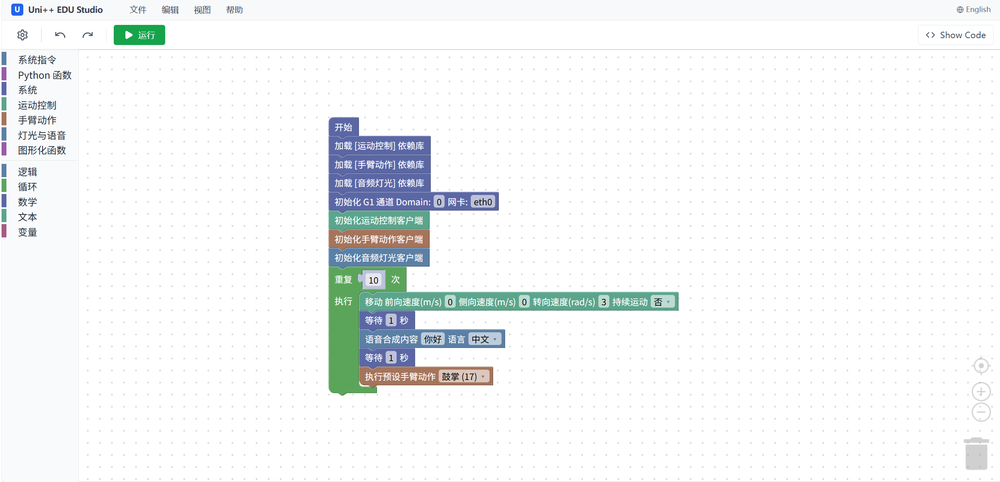

## Uni++ EDU Studio



Uni++ EDU Studio是一个基于Blockly的Unitree机器人图形化编程平台。

Uni++ EDU Studio支持运行在任意Linux平台上，但考虑便利性，推荐部署在：

- Unitree G1的PC2上
- Unitree Go2的拓展坞上

部署完成后，Web App支持被任意拥有浏览器的设备访问，但不建议竖屏模式使用。

Uni++ EDU Studio支持通过导入配置来控制不同的机器人。目前已支持的配置文件：

- Unitree G1
  - 高层控制（仅开放安全的动作）
  - 手臂动作控制
    - 支持录制好的示教动作
  - 音频灯光接口控制

配置还会持续更新，也支持自定义配置（文档将会晚些上传）。

Uni++ EDU Studio编辑器支持：

- 一键本地运行
- 自定义函数（图形化或Python）
- 自定义代码段（Python）

---

## 快速开始

提示：此处的操作需要您对Unitree机器人开发具有一定基础。

### 0000 连接机器人

以Unitree G1为例，参考此处的教程连接机器人：

[宇树科技 文档中心](https://support.unitree.com/home/zh/G1_developer/quick_development#heading-7)

### 0001 将程序拷贝到机器人的内置计算机中

推荐使用SCP工具，将本程序打包成ZIP之后传到机器人的内部计算机中。

以Unitree G1为例。(醍醐/path/to/your/zip为您打包的压缩文件的路径)

```bash
scp /path/to/your/zip.zip unitree@192.168.123.164:/home/unitree/
ssh unitree@192.168.123.164
password:123
mkdir unipp-edu-studio
mv /your/zip.zip unipp-edu-studio
cd unipp-edu-studio
unzip
```

或者可以使用MobaXterm进行图形化操作。

### 0002 设置内置计算机连接无线网络（以配置环境）

替换 `<ssid>`为您环境的无线网络名称，`<password>`为密码。

```bash
sudo nmcli device wifi connect <ssid> password <password>
```

随后需要您记住机器人的IP地址。通过ifconfig查看。随后新开一个SSH进程，**使用您刚才记住的地址连接机器人**。暂时关闭本地网卡。

```bash
ssh unitree@<ip>
password:123
sudo ifconfig eth0 down
```

### 0003 安装依赖

在backend目录下克隆依赖（unitree sdk2 python）

```bash
cd backend
git clone https://github.com/unitree/unitree_sdk2_python.git
```

回到home目录下，克隆并安装cyclone dds。

```bash
cd ~
git clone https://github.com/eclipse-cyclonedds/cyclonedds -b releases/0.10.x 
cd cyclonedds && mkdir build install && cd build
cmake .. -DCMAKE_INSTALL_PREFIX=../install
cmake --build . --target install
```

回到backend目录下，使用miniconda创建虚拟环境（预装在PC2中），并配置Unitree SDK2 Python依赖

```bash
cd ~/unipp-edu-studio
conda create -n UnippEduStudio python=3.10
conda activate UnippEduStudio
export CYCLONEDDS_HOME="/home/unitree/cyclonedds/install"
pip install -e .
```

再安装所需的其他依赖

```bash
pip install fastapi uvicorn pydantic
```

### 0004 启动

回到backend目录，启动程序

```bash
cd ~/unipp-edu-studio/backend
python -m server
```

需要注意，之后需要使用，需要先使用conda激活UnippEduStudio环境

```bash
conda activate UnippEduStudio
```

随后，同一WiFi下即可访问机器人的IP地址:5179进入Uni++ EDU Studio。

## 使用方法

### 1001 导入配置

单击界面左上角的⚙️展开配置菜单，点击“⬆️导入配置”，导入.json格式的配置文件。如/block_configurations中的g1_basic.json配置文件。不同的语言具有不同的配置文件。

### 1002 编程与保存

随后，您可以自由的进行编程。编程完毕之后，您可以在“文件”菜单选择下载工程文件。下次打开前，请先导入对应的配置文件，否则会导入失败。

编程时，注意要使用模块功能，需要先导入对应模块并完成初始化。具体的使用方法，可以看看随配置文件附带的Readme文件。

编辑器还支持导出Python文件，但不支持导入。导出的Python文件可以在Unipp EDU Studio这个conda环境下自由运行。但不支持导入解析Python文件。

### 1003 运行

运行前，请确保画布上没有离散的代码块，确保机器人周围空旷、适合运行所撰写的程序。随时准备使用阻尼模式将机器人急停。

点击“▶️运行”按钮进行运行。再次点击以手动结束。
