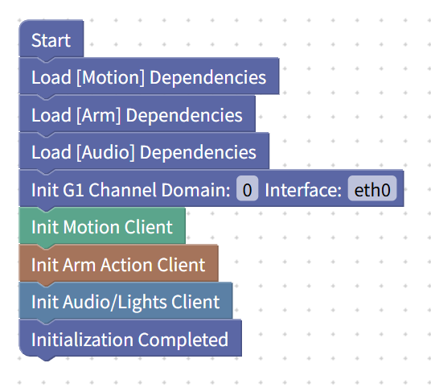

## Uni++ EDU Studio Configuration File: Unitree G1 Basic Program

This configuration file includes:

* **Unitree G1 High-level Control** (only safe actions are accessible)
* **Arm Motion Control**
  * Supports pre-recorded teaching actions
* **Audio and Light Interface Control**

This configuration is designed for K-12 programming and beginners, shielding all functions that could potentially be dangerous or cause damage to the robot.

---

## Supported Models

* Unitree G1 EDU Flagship (U1 only supports partial actions)
* Unitree G1 EDU Professional

**Not Compatible With:**

* Unitree G1 Basic / Air
* Unitree G1-D Data Collection Kit

---

## Usage Notice

Before programming, please ensure the Unitree G1 is powered on normally, standing up, and has entered any motion control mode. **Usage is not supported while the robot is in a lying position.**

To use motion control, arm actions, or audio/light features, you must first initialize the respective dependencies and the robot. The initialization process is shown in the image below:

If you are deploying Uni++ EDU Studio on the Unitree G1's  **PC2** , there is no need to modify the **Domain** or  **Network Interface Card (NIC)** . Otherwise, please modify these settings according to your specific hardware setup.

---

**Translation Complete.** I have maintained the technical terminology and the specific request regarding the image placeholder format.

Would you like me to translate more documentation or help you with the custom configuration upload guide?
