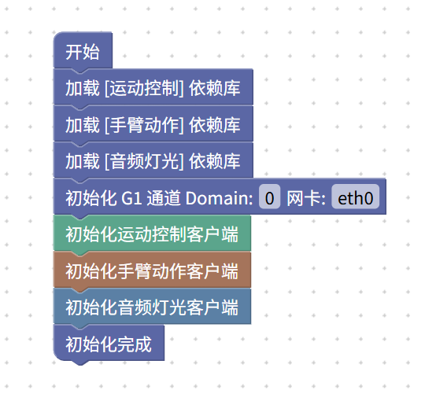

## Uni++ EDU Studio配置文件：Unitree G1基础程序

本旧版配置文件描述：

- Unitree G1- 高层控制（仅开放安全的动作）
- 手臂动作控制
  - 支持录制好的示教动作
- 音频灯光接口控制

此配置最初面向少儿编程与新手设计；它不代表其中的动作已针对特定机器人完成安全验证。

> 当前 Web IDE 和 Blockly 积木箱使用共享的可执行命令目录，而不是此旧版 JSON。实体机器人运行通过应用 SDK 适配器开放有界运动控制、16 个固定内置手臂预设、只读手臂动作诊断及部分音频控制。未开放任意录制动作名称、原始 FSM 控制和二进制音频流。G1 SDK 未提供手臂动作取消 API；应用的停止按钮仅停止行走运动。

## 适配机型

- Unitree G1 EDU 旗舰版(U1仅支持部分动作)
- Unitree G1 EDU 专业版

不适配：

- Unitree G1基础版/Air
- Unitree G1-D 数采套装

## 使用须知

编程之前，需要先请您将Unitree G1正常开机并站起，进入任意运控。**不支持在躺姿下使用**。

要使用运动控制、手臂动作、音频灯光之前，需要先对各个依赖及机器人进行初始化。初始化如图所示：

如果您是在Unitree G1的PC2上部署Uni++ EDU Studio，则不需要修改Domain和网卡。否则，请按照您的设备情况进行修改。
